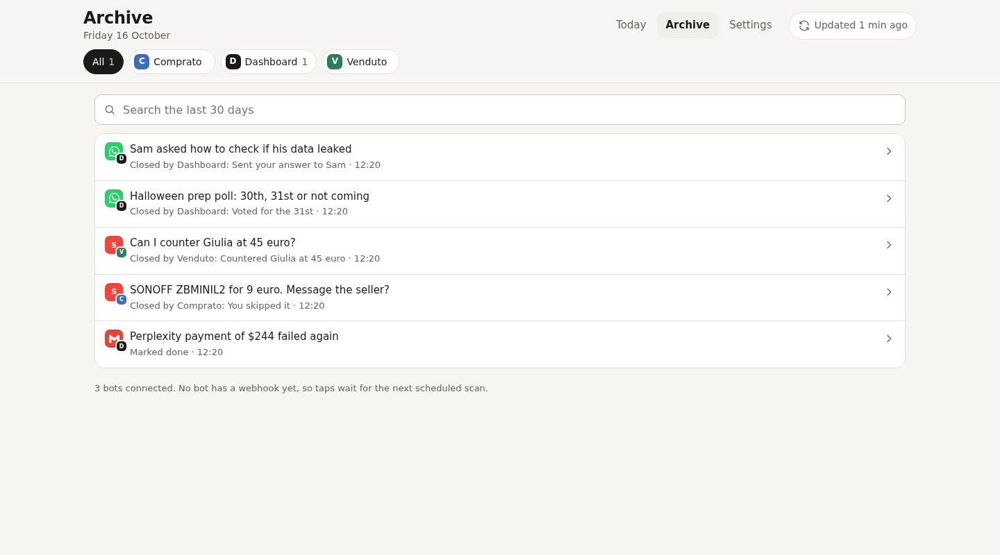
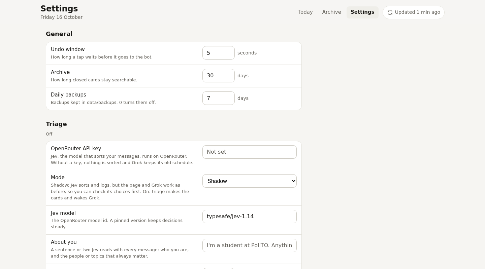

<p align="center">
  
</p>

<h1 align="center">Grok Bot Dashboard</h1>

<p align="center">
  One page for everything your Grok Bots want from you: questions waiting for an answer, your to-dos, today's agenda and a catch-up of busy chats.<br>
  It runs on your own computer, opens only for your Tailscale account, and you answer with a tap instead of scrolling a chat thread.
</p>

<p align="center">
  <a href="https://github.com/SuperTost100/Grok-Bot-Dashboard/actions/workflows/ci.yml"></a>
  <a href="LICENSE"></a>
  
</p>

<p align="center">
  <a href="#start">Start</a> ·
  <a href="#documentation">Documentation</a>
</p>

<picture>
  <source media="(prefers-color-scheme: dark)" srcset="docs/screenshots/today-dark.png">
  
</picture>

## Why Grok Bot Dashboard

Grok Bots ask their questions in a chat thread, where they scroll away. The dashboard collects what the bots found on one page, and each card carries the answers the bot suggests. Tap one and the bot acts within seconds.

There's no account to create and nothing to pay for beyond the Grok Bot subscription you already have. The server is a single Node.js process with one SQLite file. It listens on `127.0.0.1` and opens only for your Tailscale account. On a phone, add it to your home screen and it opens full screen like an app.

## What it does

**Collect what needs you.** Your bots post cards: a question with suggested answers, a reply they drafted, a yes/no approval, a reminder. Urgent ones sort first with their deadline.

**Answer in one tap.** Pick an answer, send or edit a draft, snooze, or write the bot an instruction. Anything that reaches other people waits 5 seconds with Undo, then goes to the bot that posted the card.

**See your day.** To-dos come straight from Todoist, and you tick them off on the page. Next to them sit today's and tomorrow's agenda and one-paragraph summaries of busy group chats and mailboxes.

**Bring in PoliTO avvisi.** Optional. Unread course avvisi and school messages from the Politecnico di Torino become cards, and marking one read here marks it read in the PoliTO app too. [More in the PoliTO guide](docs/polito.md).

**Read WhatsApp, mail and calendar yourself.** Optional and read-only. The dashboard reads WhatsApp through WAHA, up to three mailboxes over IMAP and your calendars through iCal, so the bot doesn't have to scan them on a schedule. [Set it up in the sources guide](docs/sources.md).

**Sort messages with Jev.** Optional. A small decision model on OpenRouter rates new messages, so the Grok Bot runs only when one needs a reply. 160 decisions cost under 1¢. [How triage works](docs/triage.md).

**Keep a 30-day archive.** Everything you answered, dismissed or snoozed stays searchable, with what the bot did about it.

<table>
  <tr>
    <td width="50%">
      <picture>
        <source media="(prefers-color-scheme: dark)" srcset="docs/screenshots/archive-dark.png">
        
      </picture>
    </td>
    <td width="50%">
      <picture>
        <source media="(prefers-color-scheme: dark)" srcset="docs/screenshots/settings-dark.png">
        
      </picture>
    </td>
  </tr>
  <tr>
    <td>The archive keeps closed cards for 30 days, with the bot's note.</td>
    <td>Settings change the undo window, triage and sources without a restart.</td>
  </tr>
</table>

## How it fits with Grok Bot

A Grok Bot named "Dashboard" scans your WhatsApp, mail and calendar on a schedule (every 2 hours by default) and posts cards with the `grokdash` command. When you tap something, the dashboard calls the bot's webhook routine and the bot acts within seconds. Your existing secretary bot stops sending digests and only notifies you when a card is urgent. Any other bot can post cards too, and gets its own filter on the page.

[Set up the bots](bot/README.md) after the dashboard runs.

## Start

You need:

- Docker with Compose, or Node.js 24 or newer.
- [Tailscale](https://tailscale.com) on the machine that runs the dashboard and on the devices you open it from.
- The Grok Bot desktop app on a computer in the same tailnet. Your bots run their commands there.
- Optional: a Todoist API token. Without one, a bot sends your to-dos instead.
- Optional: [areadidattica](https://github.com/SuperTost100/areadidattica-cli) running on the same machine, for PoliTO avvisi.

Clone the repo and copy the example settings:

```bash
git clone https://github.com/SuperTost100/Grok-Bot-Dashboard.git
cd Grok-Bot-Dashboard
cp .env.example .env
```

Open `.env` and set `OWNER_LOGIN` to your Tailscale login and `BOT_TOKEN` to a random secret:

```bash
openssl rand -hex 24
```

`.env` holds that secret, so make it readable by you only:

```bash
chmod 600 .env
```

Create the data folder yourself so it belongs to you rather than to root, then start the container. It runs as user and group 1000. If `id -u` prints something else, set `DASHBOARD_UID` and `DASHBOARD_GID` in `.env` first.

```bash
mkdir -p data
docker compose up -d --build
```

The dashboard listens on `127.0.0.1:8787`, so only this machine can reach it. Put it on your tailnet with HTTPS:

```bash
tailscale serve --bg --https=8443 http://127.0.0.1:8787
```

Open `https://<machine-name>.<tailnet>.ts.net:8443` from any of your devices. Anyone else on the tailnet gets "This dashboard only opens for its owner's Tailscale account."

### Try it with demo data

No Docker or Tailscale needed:

```bash
npm ci
npm run dev
```

In a second terminal:

```bash
GROKDASH_URL=http://127.0.0.1:8788 GROKDASH_TOKEN=dev-token scripts/demo.sh
```

Open `http://127.0.0.1:8788`. `npm run dev` turns off the Tailscale check and keeps its data in `data-dev/`, apart from a real install's `data/`. Delete `data-dev/` when you're done.

## Configuration

Set these in `.env`. The full list with comments is in [`.env.example`](.env.example).

The Settings tab on the page changes the undo window, the archive and backup length, Todoist and PoliTO without a restart. A value saved there wins over `.env` until you press Reset. Tokens saved there are stored in `data/dashboard.db` and never sent back to the page. Your login, the bot token, the port, the time zone and the webhook rule stay in `.env` only.

| Variable                      | Required | Default     | What it does                                                             |
| ----------------------------- | -------- | ----------- | ------------------------------------------------------------------------ |
| `OWNER_LOGIN`                 | yes      |             | The Tailscale login allowed to open the page                             |
| `BOT_TOKEN`                   | yes      |             | Secret the bots send with every call                                     |
| `TZ`                          | no       | system zone | Time zone for "today", the agenda and to-do dates                        |
| `TODOIST_TOKEN`               | no       |             | Read and complete to-dos in Todoist directly                             |
| `TODOIST_FILTER`              | no       |             | Show only tasks matching a Todoist filter, like `today \| overdue \| p1` |
| `AREADIDATTICA_URL`           | no       |             | Where areadidattica answers; turns on PoliTO avvisi                      |
| `AREADIDATTICA_TOKEN`         | with URL |             | The `API_TOKEN` from areadidattica's `.env`                              |
| `WAHA_API_KEY`                | no       |             | Secret shared by WAHA and the dashboard; turns on WhatsApp               |
| `MAIL1_HOST` ... `MAIL3_HOST` | no       |             | IMAP server of each mailbox, with `_NAME`, `_USER` and `_PASSWORD`       |
| `CALENDAR_URLS`               | no       |             | Secret iCal addresses, separated by spaces                               |
| `UNDO_SECONDS`                | no       | `5`         | How long a tap waits before it goes to the bot                           |
| `ARCHIVE_DAYS`                | no       | `30`        | How long closed cards stay in the archive                                |
| `PORT`                        | no       | `8787`      | Port on `127.0.0.1`                                                      |
| `BACKUP_DAYS`                 | no       | `7`         | Daily backups kept in `data/backups`; `0` turns them off                 |
| `WEBHOOK_ALLOW_PRIVATE`       | no       | `0`         | `1` lets bots register webhooks on your LAN or tailnet                   |
| `AUTH_MODE`                   | no       | `tailscale` | `none` turns off the owner check. Only for local development.            |

## Your data

Everything lives in one SQLite file, `data/dashboard.db`, readable by your user only. These are the only things the server sends off the machine:

- **Webhook calls.** When you tap or press refresh, the server calls the webhook URL each bot registered, with no card content in it.
- **Todoist.** With `TODOIST_TOKEN` set, it reads your active tasks and completes or reopens the ones you tick.
- **Triage.** With an OpenRouter key set, the text of new messages (up to 15 per decision, cut to 1,500 characters each) goes to OpenRouter and Jev's provider, TypeSafe.
- **Phone pings.** With an ntfy topic set, urgent cards send a count and a link to that topic.
- **WhatsApp, mail and calendars.** When you set them up, it reads them through WAHA, IMAP and the iCal addresses you gave it, as described in the [sources guide](docs/sources.md).
- **areadidattica.** With `AREADIDATTICA_URL` set, it asks that local service for unread avvisi and deadlines, and tells it which ones you marked read. areadidattica is the one that talks to PoliTO.

The bots read your chats and mail inside Grok Bot, as they already do, and post only the summaries you see.

The server writes a consistent copy of the database to `data/backups/` once a day and keeps the last 7. [The backups guide](docs/backups.md) covers backing up right now and restoring.

## Development

You need Node.js 24 or newer.

```bash
npm ci          # installs TypeScript and the mail and calendar libraries
npm test        # runs the API tests
npm run check   # typechecks
```

The server is plain TypeScript run by Node 24 directly, with no build step. HTTP, SQLite and `fetch` come from Node. Mail and calendars use three small libraries (`imapflow`, `postal-mime` and `ical.js`). The page is plain HTML, CSS and JavaScript in `public/`. CI runs the same checks, syntax-checks the shell scripts and builds the Docker image.

## Documentation

| Read this                                          | To learn                                                    |
| -------------------------------------------------- | ----------------------------------------------------------- |
| [Set up the bots](bot/README.md)                   | Install `grokdash`, create the Dashboard bot, add a webhook |
| [Dashboard bot instructions](bot/dashboard-bot.md) | The prompt that makes a Grok Bot keep the page current      |
| [Secretary changes](bot/secretary.md)              | Turn your current assistant into the urgent-card notifier   |
| [WhatsApp, mail and calendar](docs/sources.md)     | Let the dashboard read your sources itself                  |
| [Triage with Jev](docs/triage.md)                  | How new messages are sorted and when Grok wakes             |
| [PoliTO avvisi](docs/polito.md)                    | Course avvisi and deadlines through areadidattica           |
| [Backups](docs/backups.md)                         | Daily copies, a backup right now, and restoring             |
| [API reference](docs/API.md)                       | Every endpoint, for bots that don't use `grokdash`          |

## License

MIT, see [`LICENSE`](LICENSE).
