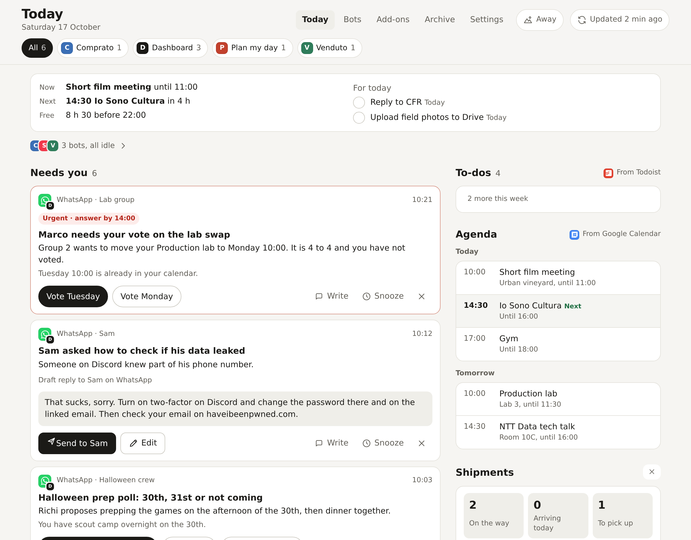
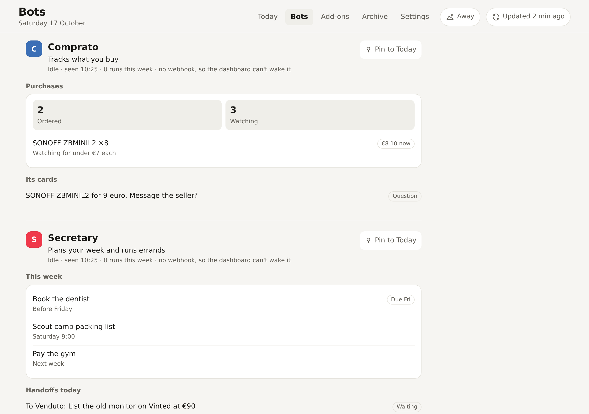

<p align="center">
  
</p>

<h1 align="center">Grok Bot Dashboard</h1>

<p align="center">
  One page for everything your Grok Bots want from you: questions waiting for an answer, your to-dos, today's agenda and a catch-up of busy chats.<br>
  It runs on your own computer, opens only for your Tailscale account, and you answer with a tap instead of scrolling a chat thread.
</p>

<p align="center">
  <a href="https://github.com/SuperTost100/Grok-Bot-Dashboard/actions/workflows/ci.yml"></a>
  <a href="LICENSE"></a>
  
</p>

<p align="center">
  <a href="#start">Start</a> ·
  <a href="#documentation">Documentation</a>
</p>

<picture>
  <source media="(prefers-color-scheme: dark)" srcset="docs/screenshots/today-dark.png">
  
</picture>

## Why Grok Bot Dashboard

Grok Bots ask their questions in a chat thread, where they scroll away. The dashboard collects what the bots found on one page, and each card carries the answers the bot suggests. Tap one and the bot acts within seconds.

There's no account to create and nothing to pay for beyond the Grok Bot subscription you already have. The server is a single Node.js process with one SQLite file. It listens on `127.0.0.1` and opens only for your Tailscale account. On a phone, add it to your home screen and it opens full screen like an app.

## What it does

**Collect what needs you.** Your bots post cards: a question with suggested answers, a reply they drafted, a yes/no approval. Urgent ones sort first with their deadline. Needs you shows a few cards at a time, and news and reminders go to Catch up as one line per chat or sender.

**Stay small.** What you've seen and left alone moves to the archive: news after a day, questions after three. The clock only runs while the page has shown it to you. Going hiking? Switch on Away, and nothing expires and your phone stays quiet until you're back. Then everything that came in folds into one "While you were away" line.

**Answer in one tap.** Pick an answer, send or edit a draft, snooze, or write the bot an instruction. Anything that reaches other people waits 5 seconds with Undo, then goes to the bot that posted the card.

**See your day.** A strip at the top shows what's on now or next, how much free time is left before 22:00, and three to-dos picked for today. Below sit the rest of your to-dos, today's and tomorrow's agenda, and one-line summaries of busy chats and mailboxes.

**Add your sources.** Mail, chats, calendars, to-dos and the rest come from add-ons and apps, installed from a GitHub store with one click on the Add-ons page: Todoist, Calendar, Mail, WhatsApp, PoliTO, Shipments and Plan my day are in the [default store](https://github.com/SuperTost100/grokdash-store). An add-on you don't trust runs in a container of its own and reaches only its own cards. [How add-ons work](docs/addons.md).

**Give your bots a home.** Each bot you choose gets a section on the Bots page with what it's doing and a panel it keeps current, like a selling bot's listings and offers, and you can pin a panel to Today. Bots hand work to each other, and the dashboard wakes them on a schedule that batches what can wait and keeps to a weekly budget. Bots that work behind the scenes stay off the page.

**Sort messages with Jev.** Optional. A small decision model on OpenRouter rates new messages, so the Grok Bot runs only when one needs a reply. 160 decisions cost under 1¢. [How triage works](docs/triage.md).

**Keep a 30-day archive.** Everything you answered, dismissed or snoozed stays searchable, with what the bot did about it.

<table>
  <tr>
    <td width="50%">
      <picture>
        <source media="(prefers-color-scheme: dark)" srcset="docs/screenshots/bots-dark.png">
        
      </picture>
    </td>
    <td width="50%">
      <picture>
        <source media="(prefers-color-scheme: dark)" srcset="docs/screenshots/addons-dark.png">
        
      </picture>
    </td>
  </tr>
  <tr>
    <td>Each bot you show gets its status, its panel, its cards and its handoffs.</td>
    <td>Add-ons install from a store and report how they're doing.</td>
  </tr>
</table>

## How it fits with Grok Bot

Add-ons read your WhatsApp, mail and calendar, and triage decides what needs you. When a chat needs an answer, the dashboard wakes a Grok Bot named "Dashboard", which works behind the scenes: it writes the card with the likely answers, and carries out what you tap within seconds. Your other bots (a secretary, a selling bot) keep their own panels on the Bots page, post cards when they need a decision, and hand work to each other through the dashboard. Every bot talks to it with the `grokdash` command, and the dashboard wakes them through their webhook routines on a weekly budget you set.

## Start

You need:

- Docker with Compose, or Node.js 24 or newer.
- [Tailscale](https://tailscale.com) on the machine that runs the dashboard and on the devices you open it from.
- The Grok Bot desktop app on a computer in the same tailnet. Your bots run their commands there.
- Optional: a Todoist API token. Without one, a bot sends your to-dos instead.
- Optional: [areadidattica](https://github.com/SuperTost100/areadidattica-cli) running on the same machine, for PoliTO avvisi.

Clone the repo and copy the example settings:

```bash
git clone https://github.com/SuperTost100/Grok-Bot-Dashboard.git
cd Grok-Bot-Dashboard
cp .env.example .env
```

Open `.env` and set `OWNER_LOGIN` to your Tailscale login and `BOT_TOKEN` to a random secret:

```bash
openssl rand -hex 24
```

`.env` holds that secret, so make it readable by you only:

```bash
chmod 600 .env
```

Create the data folder yourself so it belongs to you rather than to root, then start the container. It runs as user and group 1000. If `id -u` prints something else, set `DASHBOARD_UID` and `DASHBOARD_GID` in `.env` first.

```bash
mkdir -p data
docker compose up -d --build
```

The dashboard listens on `127.0.0.1:8787`, so only this machine can reach it. Put it on your tailnet with HTTPS:

```bash
tailscale serve --bg --https=8443 http://127.0.0.1:8787
```

Open `https://<machine-name>.<tailnet>.ts.net:8443` from any of your devices. Anyone else on the tailnet gets "This dashboard only opens for its owner's Tailscale account."

### Try it with demo data

No Docker or Tailscale needed:

```bash
npm ci
npm run dev
```

In a second terminal:

```bash
GROKDASH_URL=http://127.0.0.1:8788 GROKDASH_TOKEN=dev-token scripts/demo.sh
```

Open `http://127.0.0.1:8788`. `npm run dev` turns off the Tailscale check and keeps its data in `data-dev/`, apart from a real install's `data/`. Delete `data-dev/` when you're done.

## Configuration

Set these in `.env`. The full list with comments is in [`.env.example`](.env.example).

The Settings tab on the page changes the undo window, the archive and backup length, triage, wakes and phone pings without a restart. Add-ons have their own settings on the Add-ons page. A value saved there wins over `.env` until you press Reset. Tokens saved there are stored in `data/dashboard.db` and never sent back to the page. Your login, the bot token, the port, the time zone and the webhook rule stay in `.env` only.

| Variable                      | Required | Default     | What it does                                                             |
| ----------------------------- | -------- | ----------- | ------------------------------------------------------------------------ |
| `OWNER_LOGIN`                 | yes      |             | The Tailscale login allowed to open the page                             |
| `BOT_TOKEN`                   | yes      |             | Secret the bots send with every call                                     |
| `TZ`                          | no       | system zone | Time zone for "today", the agenda and to-do dates                        |
| `UNDO_SECONDS`                | no       | `5`         | How long a tap waits before it goes to the bot                           |
| `ARCHIVE_DAYS`                | no       | `30`        | How long closed cards stay in the archive                                |
| `PORT`                        | no       | `8787`      | Port on `127.0.0.1`                                                      |
| `BACKUP_DAYS`                 | no       | `7`         | Daily backups kept in `data/backups`; `0` turns them off                 |
| `WEBHOOK_ALLOW_PRIVATE`       | no       | `0`         | `1` lets bots register webhooks on your LAN or tailnet                   |
| `AUTH_MODE`                   | no       | `tailscale` | `none` turns off the owner check. Only for local development.            |

## Your data

Everything lives in one SQLite file, `data/dashboard.db`, readable by your user only. These are the only things the server sends off the machine:

- **Webhook calls.** When you tap or press refresh, the server calls the webhook URL each bot registered, with no card content in it.
- **Triage.** With an OpenRouter key set, the text of new messages (up to 15 per decision, cut to 1,500 characters each) goes to OpenRouter and Jev's provider, TypeSafe.
- **Phone pings.** With an ntfy topic set, the server tells that topic when a PoliTO deadline is due tomorrow or a reminder you snoozed comes back: a count and a link, never what the card says. It never pings for new messages, because WhatsApp and your mail app already do.
- **Add-ons and apps.** Each one you install talks to its own service (Todoist, your IMAP servers, WAHA for WhatsApp, PoliTO through areadidattica) with the settings you gave it. The [store's README](https://github.com/SuperTost100/grokdash-store#your-data) lists what each one sends where. Installing or updating one downloads its folder from GitHub.

The bots read your chats and mail inside Grok Bot, as they already do, and post only the summaries you see.

The server writes a consistent copy of the database to `data/backups/` once a day and keeps the last 7. [The backups guide](docs/backups.md) covers backing up right now and restoring.

## Development

You need Node.js 24 or newer.

```bash
npm ci          # installs TypeScript and Node's type definitions
npm test        # runs the API tests
npm run check   # typechecks
```

The server is plain TypeScript run by Node 24 directly, with no build step and no runtime dependencies: HTTP, SQLite and `fetch` come from Node. The page is plain HTML, CSS and JavaScript in `public/`. CI runs the same checks, syntax-checks the shell scripts and builds the Docker image.

## Documentation

| Read this                                          | To learn                                                    |
| -------------------------------------------------- | ----------------------------------------------------------- |
| [Set up the bots](bot/README.md)                   | Install `grokdash`, create the Dashboard bot, add a webhook |
| [Dashboard bot instructions](bot/dashboard-bot.md) | The prompt that makes a Grok Bot keep the page current      |
| [Shown bots](bot/shown-bot.md)                     | Give a bot its own section, panel and handoffs              |
| [Secretary changes](bot/secretary.md)              | What your assistant does for Plan my day                    |
| [Add-ons and apps](docs/addons.md)                 | Install sources from a store, trust, and the runner         |
| [Triage with Jev](docs/triage.md)                  | How new messages are sorted and when Grok wakes             |
| [Backups](docs/backups.md)                         | Daily copies, a backup right now, and restoring             |
| [API reference](docs/API.md)                       | Every endpoint, for bots that don't use `grokdash`          |

## License

MIT, see [`LICENSE`](LICENSE).
