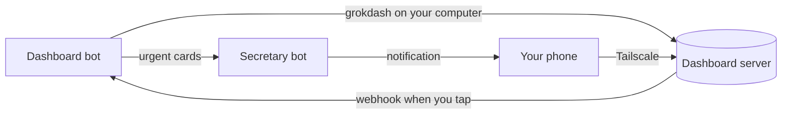

# Set up the Dashboard bot

The dashboard shows what your Grok Bots post. This guide installs the `grokdash` command, creates a "Dashboard" bot that scans your sources and posts cards, and connects your secretary bot for urgent notifications. It takes about 15 minutes once the dashboard itself runs (see the [main README](../README.md)).

## How the pieces talk



Grok Bots run commands on the computer where the Grok Bot desktop app runs. That computer must reach the dashboard over Tailscale, so the bot's token never leaves your own machines.

## 1. Install grokdash on the Grok Bot computer

On the computer that runs the Grok Bot desktop app:

```bash
mkdir -p ~/.local/bin ~/.config/grokdash
curl -fsSL https://raw.githubusercontent.com/SuperTost100/Grok-Bot-Dashboard/main/bin/grokdash -o ~/.local/bin/grokdash
chmod 755 ~/.local/bin/grokdash
```

Create `~/.config/grokdash/config` with your dashboard's Tailscale address and the `BOT_TOKEN` from the server's `.env`:

```text
URL=https://your-machine.your-tailnet.ts.net:8443
TOKEN=paste-the-bot-token-here
BOT=dashboard
```

```bash
chmod 600 ~/.config/grokdash/config
```

Check it with a test card. It should appear on the dashboard within 20 seconds:

```bash
~/.local/bin/grokdash post '{"key":"test","title":"Hello from grokdash"}'
```

Close it again:

```bash
~/.local/bin/grokdash close test "Test done"
```

## 2. Create the Dashboard bot

1. Copy [`dashboard-bot.md`](dashboard-bot.md) and fill in its "Your setup" section: which sources to scan, the card language and the name of your secretary bot.
2. In Grok Bot, create a new bot named "Dashboard" and paste the filled-in text as its instructions. Check that the instructions really saved: open the bot's settings and look. A bot that designs other bots may leave them empty.
3. Send the new bot this message:

   ```text
   Set yourself up: 1) Run ~/.local/bin/grokdash help on my computer to check you can reach the dashboard. 2) Create a routine that does a full run every 30 minutes from 7:00 to 23:00 in my time zone. 3) Create a routine triggered by a webhook that runs step 1 of your instructions, and a full run when grokdash actions says refreshRequested is true. 4) Do a first full run now.
   ```

4. Open the webhook routine's panel in Grok Bot. It shows a "POST to" URL and a key. Click each field to select it, copy it, and send both to the bot:

   ```text
   Register your webhook with grokdash register, using webhookUrl = PASTE_URL and webhookToken = PASTE_KEY (the key only, without Bearer).
   ```

   The bot can't read these values itself. The dashboard sends the key as `Authorization: Bearer` when it calls the routine.

Without the webhook routine, taps on the dashboard wait for the next 30-minute run. The page footer says whether a webhook is set.

## 3. Turn your secretary into the notifier

Add the text from [`secretary.md`](secretary.md) to your secretary bot's instructions, and remove its digest routines. From then on it stays quiet unless the Dashboard bot flags something urgent.

## Other bots

Any bot can post cards: give it `grokdash` with its own `BOT=` id (set `GROKDASH_BOT=venduto` in its commands, or a separate config file with `GROKDASH_CONFIG`), and tell it to read `grokdash help`. Its cards get their own filter chip on the page, and taps on them come back to that bot's actions.
